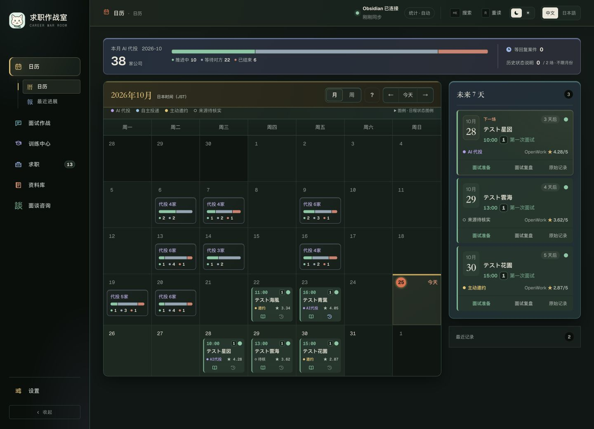
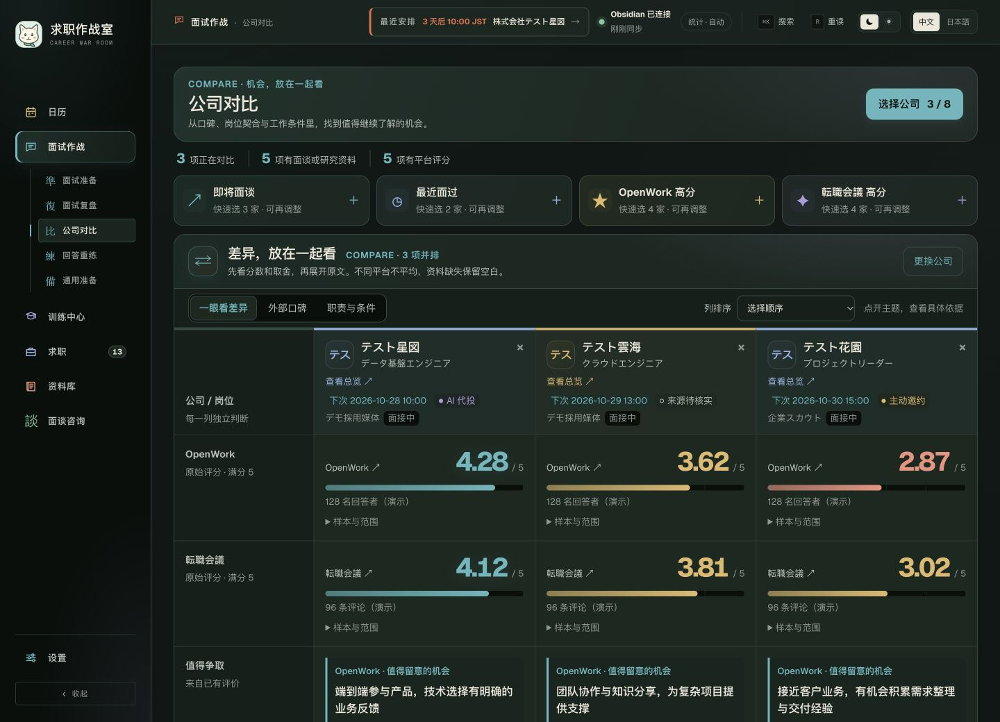
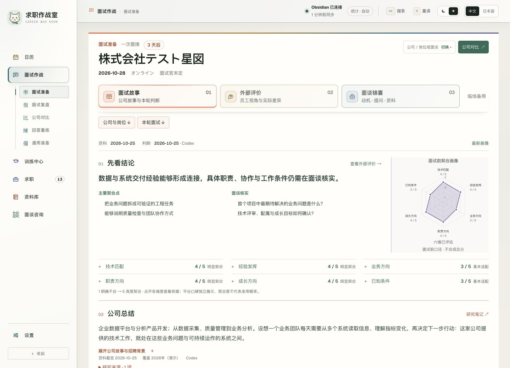
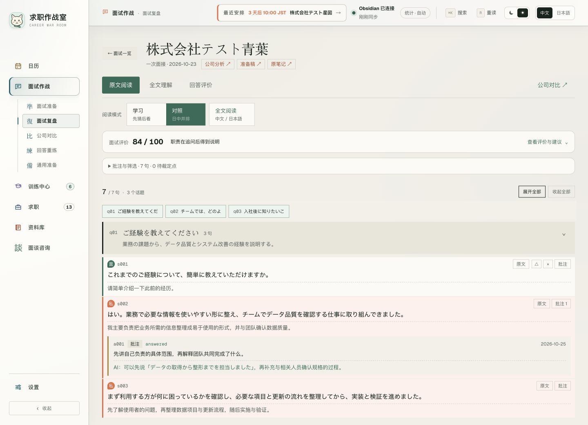
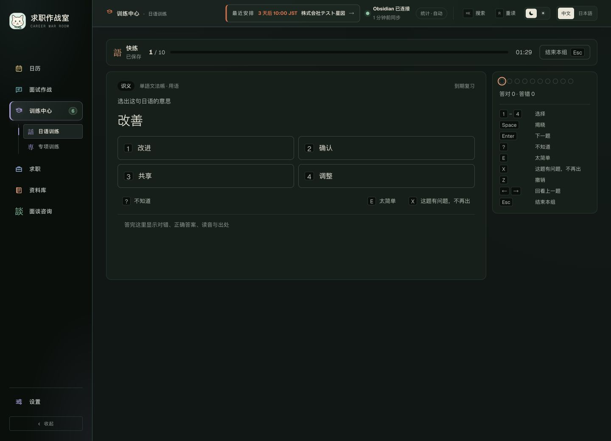
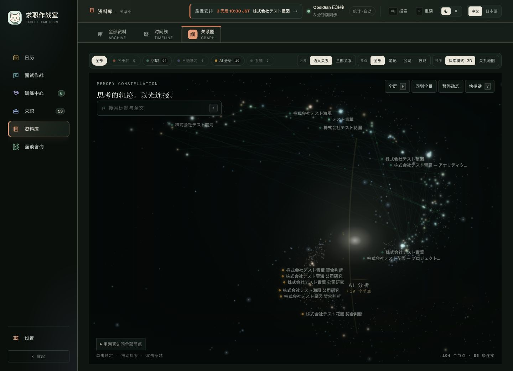
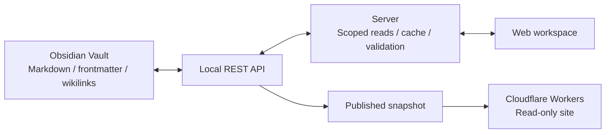

<p align="center">
  
</p>

<h1 align="center">Career Room · ObsidianWeb</h1>

<p align="center"><strong>See the schedule. Compare opportunities. Prepare the conversation. Learn from it.</strong></p>

<p align="center">
  <kbd>Local first</kbd>　<kbd>Markdown</kbd>　<kbd>D1 read model</kbd>　<kbd>中文 / 日本語</kbd>
</p>

<p align="center">
  <a href="README.md">日本語</a> · <a href="README.zh.md">中文</a> · English
</p>



<p align="center"><sub>Actual application screens. Company names, people, ratings, quoted reviews, interview records and schedules are all fictional demo data.</sub></p>

Turn an Obsidian Vault into a workspace for the next step in your job search.
Applications, interview preparation, reviews and Japanese practice stay connected through the same notes.
Your records remain Markdown; the browser gives them calendars, comparisons and focused reading views.

**[Explore the screens](#a-tour-of-the-workspace)** · **[Run locally](#run-locally)** · **[Data flow](#data-flow)**

## A tour of the workspace

### 01 · Start with the calendar

Month and week views show confirmed interviews and meetings, with links to the relevant preparation and review.
Daily bars show AI-assisted application activity, while source colours help distinguish how an opportunity arrived.
Waiting states and task deadlines are handled separately in areas such as Recent Updates.

### 02 · Put opportunities side by side



Compare up to **8 company or role entries** on a dedicated page.
Quick picks select upcoming meetings, recent interviews, highly rated OpenWork companies or highly rated Tenshoku Kaigi companies.
Role, business and interview-date hints help you recognise each option before adding it.

- **At a glance:** platform rating bars, opportunities and concerns, and six-axis fit indicators.
- **External reviews:** readable summaries, theme previews, original comments and evidence boundaries.
- **Role and conditions:** responsibilities, compensation, questions to verify and supporting sources.

Each platform keeps its own rating scale. Missing evidence stays unscored, and the selected entries are saved in the URL.

### 03 · Prepare the interview as a story



The current preparation view has **three tabs: Interview Story, External Reviews and Interview Kit**.
Read the company's background and the role's connection to your experience, consider employee perspectives,
then move to motivation, reverse questions, research links and a compact day-of-interview card.
Older preparation formats remain readable as historical notes.

### 04 · Take a review into the next answer



Connect the organised transcript, speaker decisions, personal annotations and answer evaluation.
Follow an observation back to the relevant utterance, then send an improved answer to practice.
Answer Practice asks you to speak first and reveal the example afterwards.

### 05 · Build Japanese through short practice



Move from interview expression issues and vocabulary or grammar notes into quick drills.
Immediate feedback and spaced repetition support review; focused exercises cover rephrasing, collocations and improvised expression.

### 06 · Find a note through its connections



The library, timeline and relationship map offer different routes into the same notes.
Use the 2D map for nearby connections or the 3D exploration mode for a broader view of clusters.
A full-text reader adds a table of contents, backlinks and reading-position restoration.

## Built for everyday use

| Need | What the workspace provides |
| --- | --- |
| Move to the next task | Calendar → Interview → Training → Job Search → Library; `⌘K` for navigation and search |
| Choose a comfortable appearance | Six skins, each with light and dark modes |
| Switch interface language | Chinese and Japanese navigation, commands and main menus; note content retains its original language |
| Understand the evidence | Sources, dates and unknowns remain visible; platform ratings and personal fit stay separate |
| Return to the right record | Explicit links connect companies, cases, meetings and preparation documents |

## Data flow



- **The Vault is authoritative.** Frontmatter, headings and links hold the facts. D1 stores a rebuildable query projection of catalogs, relationships, search chunks, calendar events and interview summaries; full bodies remain in the existing notes.
- **D1 data is revision-scoped.** Hosted indexes come from the same published snapshot and use a separate database from local development. Schema migrations live in `db/schema.ts` and `drizzle/`; the original read path remains available if D1 is unavailable.
- **Updates are checked.** Allowed-field changes, append-only records and version checks support local writes.
- **Statistics are regenerated.** Counts and trends are calculated from upstream records into generated blocks.
- **Publication uses a snapshot.** The hosted copy remains readable while the local computer is offline; editing and AI generation run locally.

Built with Next.js / vinext, React, TypeScript, Cloudflare Workers, three.js, MediaPipe Tasks Vision and Tailwind CSS.

## Run locally

### Prerequisites

- Node.js **22.18 or later**, npm and `jq`.
- macOS / Linux, or WSL. The startup scripts use a POSIX shell and `openssl`.
- Obsidian running with the **Local REST API** plugin configured. Enable the plugin's local service matching `OBSIDIAN_API_URL`; the default is HTTP at `http://127.0.0.1:27123`.
- A Vault following this application's note structure. An empty Vault will not contain the records shown in the demo.

After cloning the repository, run these commands from its root directory.

```bash
npm ci
OBSIDIAN_VAULT_PATH=/absolute/path/to/vault npm run dev
```

Open [http://localhost:3000](http://localhost:3000).
The startup script reads the API key from `.obsidian/plugins/obsidian-local-rest-api/data.json` and passes it to the server.
On first run, it may download MediaPipe resources used for 3D interaction.

For everyday use, `./start.sh` finds the checkout of the `main` branch and starts it on port 3000, even when launched from a temporary worktree. If dependencies are missing, it tells you to run `npm ci` in that checkout.

| Environment variable | Purpose |
| --- | --- |
| `OBSIDIAN_VAULT_PATH` | Absolute path to the Vault |
| `OBSIDIAN_CONFIG_PATH` | Override the Local REST API configuration file |
| `OBSIDIAN_API_URL` | API endpoint; defaults to `http://127.0.0.1:27123` |
| `PORT` | Web port; defaults to `3000` |
| `CODEX_BRIDGE_PORT` | Override the local AI bridge port |

AI generation and reassessment also require Codex CLI signed in with a ChatGPT account.
Saved material remains readable regardless of the AI bridge's availability.

## Development commands

| Command | Purpose |
| --- | --- |
| `npm run dev` | Start the development server with Obsidian integration and the local AI bridge |
| `npm test` | Type checks, lint, unit tests, production build and built-Worker validation |
| `npm run lint` | ESLint, with warnings treated as failures |
| `npm run vault:check` | Validate Vault frontmatter and references |
| `npm run vault:stats` | Regenerate ledger and statistics blocks |
| `npm run vault:verify` | Check Vault and generated-block consistency without writing |
| `npm run publish:prepare` | Export the current Vault snapshot and build the site |

Vault validation is separate from `npm test` because it depends on external user data.

## Publishing and data boundaries

Local mode reads and writes through Obsidian. Published mode reads the snapshot included in the deployment.
Prepare it with `npm run publish:prepare`, then use `OBSIDIAN_DATA_SOURCE=published` for the hosted runtime.
The snapshot is generated under `public/_published-vault/` and is excluded from Git.

**Review the scope and contents of the exported notes before publishing.** The source repository and demo images do not include a personal Vault or credentials.
API keys and local configuration remain on the server side. Published mode rejects write APIs and generation actions.

## Find your way around the code

```text
app/          Views, navigation and API routes
lib/          Note parsing, calendar projection, comparison and practice models
lib/server/   Obsidian access, caching, writes and published reads
scripts/      Startup, Vault validation, statistics and publication preparation
tests/        Data contracts, views, routes and build validation
docs/         Supporting documentation and README demo images
```

See [AGENTS.md](AGENTS.md) for data and update rules, and [docs/consultation.md](docs/consultation.md) for the local consultation view.

## License

This is a personal project with no open-source license currently provided. All rights reserved.
