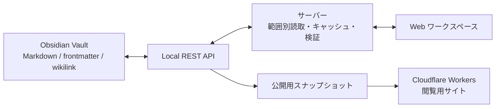

<p align="center">
  
</p>

<h1 align="center">転職作戦室 · ObsidianWeb</h1>

<p align="center"><strong>予定を見て、企業を比べ、面接を準備し、会話から学ぶ。</strong></p>

<p align="center">
  <kbd>Local first</kbd>　<kbd>Markdown</kbd>　<kbd>D1 read model</kbd>　<kbd>中文 / 日本語</kbd>
</p>

<p align="center">
  日本語 · <a href="README.zh.md">中文</a> · <a href="README.en.md">English</a>
</p>


<p align="center"><sub>以下は実際のアプリ画面です。会社名・人物・評価点・レビューの引用文・面接記録・予定は、すべて架空のデモデータです。</sub></p>

Obsidian のノートを、毎日使う転職活動の画面へ。
求人・選考状況・面接準備・振り返り・日本語練習を、同じ Vault の情報からつなぎます。
ノートは Markdown のまま保存し、ブラウザでは日程や比較、読みやすさに合わせた形で扱えます。

**[画面を見る](#画面から見る使い方)** · **[ローカルで動かす](#ローカルで動かす)** · **[仕組み](#データの流れ)**

## 画面から見る使い方

### 01 · カレンダーで、次の予定をつかむ

月・週表示から、確定した面接や面談と、その会社の準備稿・振り返りへ進めます。
AI による応募実績は日ごとのバーとして表示し、面接につながった経路も色で見分けられます。
待ちの状態や作業の期限は「最近の進展」などに分けて扱います。

### 02 · 企業比較で、機会の違いを読む


最大 **8 件の会社・ポジション**を並べて比較できます。
「これから面談」「最近面談」「OpenWork の高評価」「転職会議の高評価」からまとめて選び、
職種・事業・面談日を手がかりに候補を調整できます。

- **ひと目の違い**：サイト別の評価バー、強みと懸念、六軸の適合度。
- **外部の声**：要点をまとめた文章、テーマのプレビュー、コメント原文と読み取った範囲。
- **役割と条件**：仕事内容、待遇、確認したい事項と、その出典。

各サイトの点数はそれぞれの尺度で表示します。根拠がない評価は空欄のまま保ち、選択内容は URL に残ります。

### 03 · 面接準備を、ひとつのストーリーに


現在の準備画面は **「面接ストーリー」「外部評価」「面接ツール」** の 3 タブ構成。
会社の事業・今回の職種と経験のつながりを読み、社員の声を確認し、
志望動機・逆質問・研究資料・当日カードへ進めます。旧版の準備稿も履歴として読めます。

### 04 · 振り返りを、次の回答につなげる


会話の整理稿、話者の確認、本人の注釈、回答の評価を結びます。
指摘から該当する発言へ戻って確かめ、改善した回答を「回答練習」に送れます。
練習では先に声に出して答え、その後に回答例を確認します。

### 05 · 日本語を、短い練習で積み上げる


面接で見つかった表現の課題や、語彙・文法のノートからクイック練習へ。
一問ごとのフィードバックと間隔反復に加え、言い換えや即興表現などの練習を用意しています。

### 06 · 資料を、つながりから探し直す


資料ライブラリ、時間線、関係地図から同じノートを探せます。
2D で近くの関連を確認し、3D の探索モードでノートのまとまりを見渡すこともできます。
全文リーダーでは目次・反リンク・読書位置を使って読み進められます。

## 毎日使うための工夫

| 目的 | できること |
| --- | --- |
| 迷わず移動する | カレンダー → 面接対策 → トレーニング → 就職活動 → 資料ライブラリ。`⌘K` でページ移動と検索 |
| 自分に合う見た目にする | 6 種のスキンと、それぞれのライト・ダーク表示 |
| 表示言語を切り替える | ナビゲーション・検索コマンド・主なメニューは中文／日本語。ノート本文は原文を保持 |
| どこまで分かるか確認する | 出典・資料時点・不明点を残し、プラットフォームの点数と本人との適合度を分ける |
| 過去の資料に戻る | 会社・案件・面談・準備稿を明示的なリンクで結び、該当する記録へ移動 |

## データの流れ



- **Vault が正本。** ノートの frontmatter・見出し・リンクが事実の保存先です。D1 は日程と応募概要の再生成可能な検索用投影を持ち、本文は従来のノートから読みます。
- **D1 は版ごとに分離。** 公開版は同じ公開スナップショットから索引を作り、ローカル版とは別のデータベースを使います。移行は `db/schema.ts` と `drizzle/` で管理し、D1 が使えない場合も元の読み取り経路を保持します。
- **更新は検証してから。** 許可したフィールドの更新、追記型の記録、版の確認を組み合わせます。
- **集計は再生成。** 件数や推移などの生成区画を、上流の記録から計算します。
- **公開時はスナップショット。** 本機がオフラインでも読める副本を配信し、書き込みと AI 生成はローカルで行います。

主な実装：Next.js / vinext、React、TypeScript、Cloudflare Workers、three.js、MediaPipe Tasks Vision、Tailwind CSS。

## ローカルで動かす

### 必要なもの

- Node.js **22.18 以上**、npm、`jq`。
- macOS / Linux、または WSL。起動スクリプトは POSIX shell と `openssl` を使用します。
- 起動中の Obsidian と、設定済みの **Local REST API** プラグイン。プラグインで `OBSIDIAN_API_URL` に対応するローカルサービスを有効にします（既定は HTTP の `http://127.0.0.1:27123`）。
- このアプリのノート構造に沿った Vault。空の Vault だけでは、デモ画面の内容は表示されません。

リポジトリを clone した後、リポジトリのルートで実行します。

```bash
npm ci
OBSIDIAN_VAULT_PATH=/absolute/path/to/vault npm run dev
```

[http://localhost:3000](http://localhost:3000) を開きます。
起動スクリプトが `.obsidian/plugins/obsidian-local-rest-api/data.json` から API キーを読み、サーバーへ渡します。
初回起動では、3D 操作用の MediaPipe リソース取得が走る場合があります。

日常の起動には `./start.sh` も使えます。一時 worktree から実行しても `main` ブランチのチェックアウト先を使い、ポート 3000 で起動します。依存関係が足りない場合は、そのディレクトリで `npm ci` を実行するよう案内します。

| 環境変数 | 用途 |
| --- | --- |
| `OBSIDIAN_VAULT_PATH` | 使用する Vault の絶対パス |
| `OBSIDIAN_CONFIG_PATH` | Local REST API の設定ファイルを個別指定 |
| `OBSIDIAN_API_URL` | 接続先。既定は `http://127.0.0.1:27123` |
| `PORT` | Web サーバーのポート。既定は `3000` |
| `CODEX_BRIDGE_PORT` | ローカル AI ブリッジのポート指定 |

AI による生成・再評価には、ChatGPT アカウントでログインした Codex CLI が必要です。
保存済み資料は AI ブリッジの状態にかかわらず閲覧できます。

## 開発コマンド

| コマンド | 内容 |
| --- | --- |
| `npm run dev` | Obsidian 接続とローカル AI ブリッジを含む開発サーバー |
| `npm test` | 型検査・lint・単体テスト・本番ビルド・構築済み Worker の検証 |
| `npm run lint` | ESLint。warning も検査失敗として扱う |
| `npm run vault:check` | Vault の frontmatter と参照を検証 |
| `npm run vault:stats` | 台帳などの生成区画を再計算 |
| `npm run vault:verify` | Vault 検証と生成区画の整合確認。書き込みなし |
| `npm run publish:prepare` | 現在の Vault を公開用に書き出してビルド |

Vault の検証は、外部データを必要とするためコードの `npm test` とは分けています。

## 公開とデータの扱い

ローカルでは Obsidian を直接読み書きし、公開サイトではビルドに含めたスナップショットを読みます。
公開準備は `npm run publish:prepare`、配信時のモードは `OBSIDIAN_DATA_SOURCE=published`。
公開スナップショットは `public/_published-vault/` に生成され、Git の追跡対象から外れています。

**公開する前に、書き出されるノートの範囲と内容を確認してください。** このリポジトリのコードとデモ画像には、個人の Vault や認証情報を含めません。
API キーとローカル設定はサーバー側に保持します。公開モードでは更新 API と生成操作を拒否します。

## コードを読む

```text
app/          画面・ナビゲーション・API ルート
lib/          ノートの解析・日程投影・比較・練習のデータモデル
lib/server/   Obsidian 接続・キャッシュ・書き戻し・公開用読取
scripts/      起動・Vault 検証・集計・公開準備
tests/        データ契約・画面・ルート・構築結果の検証
docs/         補足文書と README 用のデモ画像
```

データと更新のルールは [AGENTS.md](AGENTS.md)、本機の面談相談画面は [docs/consultation.md](docs/consultation.md) にまとめています。

## ライセンス

個人プロジェクトです。現在、オープンソースライセンスは設定していません（All rights reserved）。
