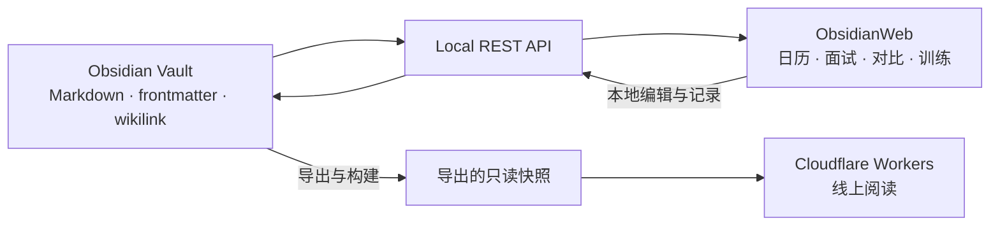

<p align="center">
  
</p>

<h1 align="center">求职作战室 · ObsidianWeb</h1>

<p align="center"><strong>把散落的求职笔记，变成看得清、能比较、可练习的下一步。</strong></p>
<p align="center">Obsidian Markdown 驱动的本地工作台：日历、面试准备、公司对比、复盘与日语训练。</p>
<p align="center"><code>Local-first</code> · <code>Markdown as data</code> · <code>无需数据库</code> · <code>Cloudflare Workers</code></p>
<p align="center"><a href="README.md">日本語</a> · <strong>简体中文</strong> · <a href="README.en.md">English</a></p>


> 本页展示实际应用界面。截图中的公司、人物、评分、评论原句和面试记录均为虚构演示，不包含个人求职资料。

## 一条连起来的工作流

**看安排 → 准备面试 → 比较机会 → 复盘回答 → 回到练习。**

邮件、求人链接、面试稿和反馈很容易各放一处。ObsidianWeb 以 Vault 中的笔记为正本，把同一家公司、同一岗位和同一场面试连接起来。界面负责整理和呈现，记录继续保留为可以阅读、搜索和版本管理的 Markdown。

| 从这里开始 | 可以做什么 |
| --- | --- |
| **日历** | 看已确认的面试与面谈，区分机会来源，进入对应准备稿或复盘；单独查看 AI 代投活动。 |
| **面试作战** | 阅读公司的故事、外部评价和面谈锦囊；并排比较公司；回看原话、评价和练习记录。 |
| **训练中心** | 练习回答、日语词汇与表达，让面试中发现的问题回到复习。 |
| **求职** | 查看岗位机会、选考状态、跟进信息和渠道分析。 |
| **资料库** | 按条件搜索笔记，沿时间线回看，或从关系图探索材料之间的联系。 |

## 看看实际界面

### 日历：先看到真正约好的事

月／周视图统一使用日本时间。每场面试可以分别进入准备和复盘，已有公司评分也能直接查看。AI 代投以独立活动和进度条展示，机会来源用颜色区分。

准备任务、回复等待和跟进期限留在“最近进展”，不会变成面试占用。

### 面试准备：先读故事，再进入细节


三个主要标签把阅读顺序收拢为 **面试故事、外部评价、面谈锦囊**。公司与岗位信息连接到候选人的经历，再落到志望动机、逆質問和临场卡；研究来源可以继续展开查看。不同轮次、旧版与新版准备稿可以共存。

### 公司对比：把分数背后的取舍放在一起看


最多并排比较 **8 个公司／岗位**。可以按即将面谈、最近面过、OpenWork 高分或転職会議高分快速选组，也可以搜索业务和岗位。

- 先看岗位、时间、来源和平台原始评分，再读机会与疑虑。
- 两个平台分别展示；公司口碑与岗位契合采用各自的量尺。
- 缺失资料留空，样本范围、评价原文和判断依据按需展开。
- 所选正本路径保存在 URL，刷新或返回后可以接着比较。

### 面试复盘：回到对话发生的地方


从原文阅读进入全文理解与回答评价。证据链接定位到具体问题和句子，说话者裁定与本人批注保留在记录中。改进后的回答可以继续进入重练，复盘与练习连成一条路径。

### 日语训练：把面试反馈变成下一次练习


词汇、语法、面试表达和专项练习集中在训练中心。到期复习、错题和练习记录帮助安排接下来练什么；回答重练则连接真实面试中的改进句。

### 资料库：从一份材料走到另一份材料


列表、时间线和关系图读取同一批笔记。默认使用易于定位的二维视图，也提供基于 three.js 的三维探索和可选手势交互。

界面提供多套配色皮肤与深浅模式。中文／日文切换覆盖导航、命令和主要菜单；笔记标题、原文和部分内容保留原语言。

## 数据留在哪里



- **Markdown 是正本。** 无需额外数据库；结构化 frontmatter、正文和双链共同组成数据模型。
- **缓存与汇总可以重建。** 派生统计由脚本生成，避免手写数字与上游记录脱节。
- **证据跟着判断走。** 外部评价、公司资料和岗位判断保留来源及阅读范围。
- **本地与线上职责明确。** 本地连接 Obsidian 进行编辑和 AI 生成；线上可以发布独立只读快照，电脑离线后仍可阅读。

## 本地运行

本地脚本面向 **macOS / Linux（Windows 可使用 WSL）**，需要 **Node.js ≥ 22.18、npm、jq、POSIX shell 和 openssl**，以及已运行并启用 **Local REST API** 插件的 Obsidian。

```bash
git clone https://github.com/xiaokan0231-max/ObsidianWeb.git
cd ObsidianWeb
npm ci

OBSIDIAN_VAULT_PATH=/absolute/path/to/your-vault npm run dev
```

打开 [http://localhost:3000](http://localhost:3000)。启动脚本从指定 Vault 的插件配置读取 API key，只传给服务端进程。请在插件中启用与 `OBSIDIAN_API_URL` 匹配的本地服务；默认地址是 `http://127.0.0.1:27123`。

日常也可运行 `./start.sh`：它会找到 `main` 分支的检出目录并在端口 3000 启动，即使从临时 worktree 打开也使用同一工作区。依赖缺失时会提示在该目录执行 `npm ci`。

| 可选配置 | 用途 |
| --- | --- |
| `OBSIDIAN_CONFIG_PATH` | 插件配置文件不在默认位置时指定路径。 |
| `OBSIDIAN_API_URL` | 覆盖本地 REST API 地址。 |
| `CODEX_BRIDGE_PORT` | 指定本地 AI 桥端口；未指定时自动选择。 |

AI 生成另需可用的 Codex CLI，并通过 ChatGPT 登录；本地桥拒绝 API-key 登录方式。浏览已有资料不要求 AI 功能可用。

这是围绕结构化 Vault 构建的工作台。空 Vault 不会自动拥有岗位、面试或训练数据；界面能力取决于相应笔记及字段是否存在。

## 开发与检查

```bash
npm test               # 类型、lint、单测、生产构建与渲染检查
npm run lint           # 代码规范检查
npm run vault:check    # 校验 Vault 的类型、枚举和引用
npm run vault:stats    # 重建派生统计和生成区块
npm run vault:verify   # 只读核验 Vault 与派生统计
```

Vault 是外部数据，因此校验与代码测试分开运行。`npm run dev` 会在启动时进行轻量检查；不要手工编辑标有 `generated` 的统计区块。

| 目录 | 职责 |
| --- | --- |
| `app/` | React 页面、导航、交互和 API 路由。 |
| `lib/` | 笔记解析、日程投影、公司评价和训练等领域逻辑。 |
| `lib/server/` | Obsidian 连接、缓存、受控写回与本地桥。 |
| `scripts/` | 启动、校验、统计、资源准备和发布导出。 |
| `tests/` | 基于 `node:test` 的数据、路由与界面契约检查。 |

技术栈：**Next.js / vinext、React、TypeScript、Cloudflare Workers、three.js、MediaPipe、Tailwind CSS 与主题令牌。**

## 发布与资料边界

### 老师交流与原文批注

`/consultation` 提供可跳过、可重放的日文聚焦引导：背景变暗，逐步突出实际按钮与阅读区域；段落和选中文字都可以批注。`/feedback` 集中查看建议、回复和处理状态；全站也能针对当前页面发起咨询。引导不在正文中占据大块空间，也不会自动发送留言。

老师通过共用访问码和显示名进入，受邀老师与本人共同查看交流。本人使用独立管理凭据，可更换访问码、隐藏误发话题和标记处理进度；更换访问码会撤销老师已有会话。普通访客只能阅读资料。

交流记录单独保存在私有 R2 信箱中，不进入 Vault 快照或自动 AI 输入。运行时需要 `FEEDBACK_SESSION_SECRET`、`FEEDBACK_OWNER_SECRET`（均至少 32 字符）和初始 `FEEDBACK_ACCESS_CODE`（至少 8 字符），通过 Sites 秘密环境变量配置；`.openai/hosting.json` 只声明 `FEEDBACK_BUCKET` 绑定，不放凭据。

本机私有 `.env.feedback.local` 可配置同名变量和 `FEEDBACK_REMOTE_URL`，仅由开发服务器读取。启用远端地址后，本机通过服务端代理以本人身份读写同一个云端信箱，浏览器不持有管理密钥。发布构建不注入这些开发变量。

运行 `npm run publish:prepare` 会重新导出 Vault 并构建网站。线上运行时设置 `OBSIDIAN_DATA_SOURCE=published`，并通过 Cloudflare `ASSETS` 绑定读取部署内的快照。

发布快照位于 Git 忽略的 `public/_published-vault/`，只进入部署产物。它包含实际笔记内容，发布前应确认适合目标访问范围。只更新代码不会自动更新线上笔记。

本机配置、API key、私有 Vault 和个人材料不应提交到公开源码仓库；本 README 的图片均为虚构演示。公开源码与公开个人内容是两件分别决定的事。

## 许可

个人项目，目前未提供开源许可证；保留所有权利。
